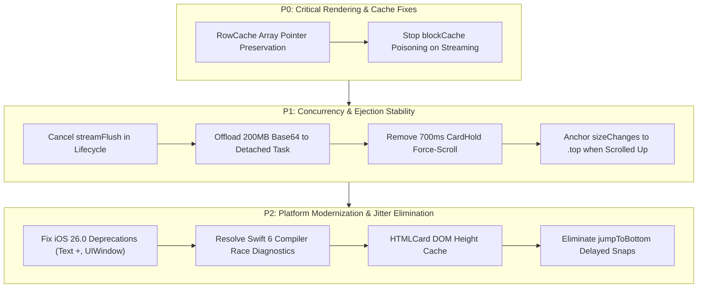

# Vory Chat Performance, Stability & iOS Platform Safety Audit

**Date**: 2026-11-02  
**Target Platform**: iOS 26.0 (Deployment Target) / iOS 27.2 (Base SDK)  
**Swift Concurrency Mode**: Swift 6 (`SWIFT_STRICT_CONCURRENCY = complete`)  
**Target Hardware**: iPhone 17 (`iPhone18,3` / `platform=iOS Simulator,name=iPhone 17`)  
**Audited Subsystems**:
- Chat UI & Virtualization: [`Vory/Chat/`](file:///Users/andrew/Documents/GitHub/Vory/Vory/Chat/)
- Core Runtime, Networking & Streaming Engine: [`Packages/VoryCore/Sources/VoryCore/`](file:///Users/andrew/Documents/GitHub/Vory/Packages/VoryCore/Sources/VoryCore/)
- Application Lifecycle, Push & Geometry: [`Vory/App/`](file:///Users/andrew/Documents/GitHub/Vory/Vory/App/), [`Vory/Push/`](file:///Users/andrew/Documents/GitHub/Vory/Vory/Push/)

---

## Table of Contents
1. [Executive Summary](#1-executive-summary)
2. [Chat Performance & Rendering Bottlenecks](#2-chat-performance--rendering-bottlenecks)
3. [Chat Jumping, Viewport Jank & Anchoring Mechanics](#3-chat-jumping-viewport-jank--anchoring-mechanics)
4. [Modern Apple Platform Safety & iOS 26.0 Compliance](#4-modern-apple-platform-safety--ios-260-compliance)
5. [ARC Memory Safety & Resource Eviction](#5-arc-memory-safety--resource-eviction)
6. [Prioritized Remediation Roadmap](#6-prioritized-remediation-roadmap)

---

## 1. Executive Summary

This deep forensic audit investigated the performance, stability, viewport anchoring, and modern platform compliance of Vory's chat subsystem. The analysis combined static AST parsing, compiler verification under Swift 6 on Xcode with the iOS 27.2 SDK, and runtime control-flow analysis.

### Primary Audit Conclusions
- **Rendering Throughput**: Streaming tokens at 25+ Hz degrades main-thread frame budgets due to two critical bugs: (1) `RowCache` invalidating array pointer equality, triggering full $O(N)$ deep structural traversals and date formatting across all historical rows on every token, and (2) intermediate streaming prefixes flooding `blockCache`, evicting settled historical markdown blocks and forcing full re-parses when scrolling history.
- **Viewport Stability ("Chat Jumping")**: Seven distinct structural mechanisms cause visible jerks, content drifting, and accidental ejections:
  1. Unconditional `.bottom` size anchoring in `TranscriptView` during background token arrival.
  2. A hardcoded 700ms `CardHold` timer that violently ejects users inspecting reasoning/tool cards back to the bottom while a turn is active.
  3. Array offset keying (`id: \.offset`) in `MarkdownView` that desynchronizes block identity and HTML card toggles.
  4. Off-screen `HTMLCardView` visibility eviction resetting heights to 96 pt and re-measuring asynchronously.
  5. A 4-stage cascading inset settle loop and a 600ms delayed overscroll poll on keyboard dismiss.
  6. A rigid 20-row threshold for history concealment that forces un-animated snaps for 1–19 message arrivals.
  7. A multi-stage snap sequence in `jumpToBottom()` that introduces visible hitches.
- **Platform Modernity & Concurrency**: While Vory demonstrates strong adoption of modern Apple frameworks (100% SwiftUI `@Observable`, `.onGeometryChange`, `.onScrollGeometryChange`, Liquid Glass effects), active compiler deprecations (`Text + Text`, `UIWindow.init()`, `appStoreReceiptURL`) and Swift 6 data-race warnings (`ChatListView` `async let` access, `TranscriptView` KVO observer closures) are present. Furthermore, 41 `NSLock` and 68 `nonisolated(unsafe)` occurrences represent opportunities for modernization to `Synchronization.Mutex<T>`.

---

## 2. Chat Performance & Rendering Bottlenecks

### 🔴 P0-1: `RowCache` Array Pointer Invalidation ($O(N)$ at 25 Hz)
- **Location**: [`TranscriptView.swift:1458-1478`](file:///Users/andrew/Documents/GitHub/Vory/Vory/Chat/TranscriptView.swift#L1458-L1478), [`RowCacheTests.swift:141-147`](file:///Users/andrew/Documents/GitHub/Vory/VoryTests/RowCacheTests.swift#L141-L147)
- **Mechanics**:
  - `TranscriptRowModel.build(visibleItems)` executes on `@MainActor` on every arriving token.
  - In `RowCache.rows(for:key:)`, when `key.items` changes, `olderSplit = nil` is unconditionally reset:
    ```swift
    if priorKey?.items != key.items {
        olderSplit = nil
    }
    ```
  - This forces a new array allocation for `built[..<split]`.
  - In `OlderRows.==`, Swift checks `a.rows == b.rows`. When buffer pointer identity (`baseAddress`) fails due to the new allocation, Swift falls back to an $O(N)$ structural comparison across every single historical row and formats timestamps (`label(for:now:)`) via Foundation at up to 25 times per second.
- **Remediation**: If `key.items` changes only at the tail (i.e. `built[..<split]` elements are identical), preserve the existing `older` array storage reference so `OlderRows.==` terminates immediately in $O(1)$ time via pointer equality.

### 🔴 P0-2: Streaming Cache Poisoning Storm in `blockCache`
- **Location**: [`TranscriptView.swift:2425-2450`](file:///Users/andrew/Documents/GitHub/Vory/Vory/Chat/TranscriptView.swift#L2425-L2450)
- **Mechanics**:
  - `blockCache` is an `NSCache<NSString, BlocksBox>` configured with `countLimit = 400` and `totalCostLimit = 4_000_000`.
  - In `MarkdownView.blocks(_ text:)`:
    ```swift
    blockCache.setObject(BlocksBox(parsed.blocks), forKey: key, cost: text.utf8.count)
    ```
  - During streaming, every token flush inserts the accumulated partial string prefix into `blockCache`.
  - A single 400-token streaming turn creates 400 ephemeral entries, **completely evicting all settled historical message blocks** from the cache.
  - When the user scrolls back to historical messages, every past message suffers a cache miss and must be re-parsed from raw markdown.
- **Remediation**: Guard cache insertion so that only settled messages (`streaming == false`) are placed into `blockCache`. Ephemeral streaming prefixes must never enter the cache.

### 🟠 P1-1: Orphaned `streamFlush` Debounce Task Races Across Turns
- **Location**: [`ChatSession.swift:1942-1961`](file:///Users/andrew/Documents/GitHub/Vory/Packages/VoryCore/Sources/VoryCore/Chat/ChatSession.swift#L1942-L1961), [`1983-2035`](file:///Users/andrew/Documents/GitHub/Vory/Packages/VoryCore/Sources/VoryCore/Chat/ChatSession.swift#L1983-L2035)
- **Mechanics**:
  - `scheduleStreamingUpdate()` manages debounced UI flushes:
    ```swift
    guard streamFlush == nil else { return }
    streamFlush = Task { [weak self] in
        try? await Task.sleep(for: wait)
        guard let self, !Task.isCancelled else { return }
        self.streamFlush = nil
        self.updateStreamingItem()
    }
    ```
  - Neither `sealStreamingForTool()` nor `finishStreaming()` cancels `streamFlush`.
  - If a turn completes while `streamFlush` is sleeping, a subsequent turn starting immediately finds `streamFlush != nil` at line 1943. Intermediate token flushes for the new turn are silently dropped until the old sleeping task wakes up.
- **Remediation**: Explicitly cancel and nil out `streamFlush` inside `sealStreamingForTool()` and `finishStreaming()`.

### 🟠 P1-2: Synchronous 200MB Base64 File Encoding on `@MainActor`
- **Location**: [`ChatSession.swift:1164-1178`](file:///Users/andrew/Documents/GitHub/Vory/Packages/VoryCore/Sources/VoryCore/Chat/ChatSession.swift#L1164-L1178), [`ComposerView.swift:1035`](file:///Users/andrew/Documents/GitHub/Vory/Vory/Chat/ComposerView.swift#L1035)
- **Mechanics**:
  - When staging attachments, `Data(contentsOf:)`, disk writing, and `data.base64EncodedString()` execute directly on `@MainActor`.
  - For files approaching the 200MB limit, Base64 encoding synchronously allocates ~267MB of string buffers, blocking the main run loop for multiple seconds and risking iOS watchdog (`0x8badf00d`) termination.
- **Remediation**: Offload disk reads, Base64 encoding, and JSON-RPC dictionary construction to `Task.detached(priority: .userInitiated)`. Dispatch only the completed payload back to `@MainActor`.

### 🟡 P2-1: Unbounded Session Retention in `ChatRegistry`
- **Location**: [`ChatRegistry.swift:7-27`](file:///Users/andrew/Documents/GitHub/Vory/Packages/VoryCore/Sources/VoryCore/Runtime/ChatRegistry.swift#L7-L27), [`ConversationView.swift:125-133`](file:///Users/andrew/Documents/GitHub/Vory/Vory/Chat/ConversationView.swift#L125-L133)
- **Mechanics**:
  - `ConversationView.onDisappear` clears `visibleChatID` but does not invoke `closeChat`.
  - `ChatRegistry.all` retains strong references to all opened `ChatSession` instances and their full item histories in RAM.
  - On gateway reconnection, `GatewayRuntime.swift:419` sequentially executes `for chat in registry.all { await chat.reattachAfterReconnect() }`. A network timeout on an inactive chat blocks reconnection for the active chat.
- **Remediation**: Evict dismissed sessions from memory using an LRU cache or explicit teardown, and parallelize `reattachAfterReconnect()` via `withTaskGroup`.

---

## 3. Chat Jumping, Viewport Jank & Anchoring Mechanics

### 3.1 Upward Content Drift During Streaming
- **Location**: [`TranscriptView.swift:430-435`](file:///Users/andrew/Documents/GitHub/Vory/Vory/Chat/TranscriptView.swift#L430-L435)
- **Mechanics**:
  ```swift
  .defaultScrollAnchor(.bottom, for: .initialOffset)
  .defaultScrollAnchor(.bottom, for: .alignment)
  .defaultScrollAnchor(holdingCard ? .top : .bottom, for: .sizeChanges)
  ```
  - Size changes anchor to `.bottom` whenever `holdingCard == false`.
  - When a user scrolls up to read history while the assistant streams tokens at the bottom, SwiftUI pins the bottom edge upon bubble height growth, pushing the historical text upward on every token batch.
- **Remediation**: Check `awayFromBottom`:
  ```swift
  .defaultScrollAnchor(awayFromBottom ? .top : (holdingCard ? .top : .bottom), for: .sizeChanges)
  ```

### 3.2 The 700ms `CardHold` Force-Scroll Ejection Bug
- **Location**: [`TranscriptView.swift:596-614`](file:///Users/andrew/Documents/GitHub/Vory/Vory/Chat/TranscriptView.swift#L596-L614)
- **Mechanics**:
  - When expanding a tool or reasoning card, `CardHold` holds the card position.
  - Line 609 unconditionally evaluates `let follow = followAfterHold || chat.isRunning`.
  - If the model is executing (`chat.isRunning == true`), after 700ms the hold expires and line 611 executes an animated `.scrollTo(edge: .bottom)`.
  - **Result**: Users attempting to inspect a tool call or thinking process mid-turn are violently yanked down to the bottom after 700ms.
- **Remediation**: Remove `|| chat.isRunning`. Only follow if `followAfterHold` is true and the user has not interacted with an open disclosure.

### 3.3 `MarkdownView` Array Offset Keying & Toggle Desynchronization
- **Location**: [`TranscriptView.swift:2488-2493`](file:///Users/andrew/Documents/GitHub/Vory/Vory/Chat/TranscriptView.swift#L2488-L2493)
- **Mechanics**:
  - `MarkdownBlock` conforms to `Identifiable` via `hashValue`. However, `TranscriptView` renders blocks using `ForEach(Array(blocks.enumerated()), id: \.offset)` because `@State private var sourceShown: Set<Int>` stores raw array indices.
  - When markdown parsing updates block count or merges lines during streaming, indices shift. Existing block views are recycled with mismatched internal state, and HTML source toggles flip on unrelated blocks.
- **Remediation**: Track expanded source cards by stable block hash/ID rather than array offset, and key `ForEach` on `\.id`.

### 3.4 `HTMLCardView` Visibility Teardown & Height Reset
- **Location**: [`HTMLCard.swift:214-225`](file:///Users/andrew/Documents/GitHub/Vory/Vory/Chat/HTMLCard.swift#L214-L225)
- **Mechanics**:
  - When an HTML card scrolls off-screen for 4 seconds, `HTMLCardView` deallocates its `WKWebView` (`near = false; loaded = false`).
  - Scrolling back into view re-creates the view at default `@State private var height: CGFloat = 96`.
  - Once the DOM loads and JavaScript evaluation finishes, `height` jumps from 96 pt to its full height (e.g. 400+ pt), creating severe layout hitches during history review.
- **Remediation**: Persist evaluated DOM heights in an in-memory dictionary keyed by card ID so remounted cards immediately render at their true height.

### 3.5 Keyboard Inset Settle Cascades & Post-Dismiss Overscroll Trap
- **Location**: [`TranscriptView.swift:474-484, 677-693, 859, 919-931`](file:///Users/andrew/Documents/GitHub/Vory/Vory/Chat/TranscriptView.swift#L474)
- **Mechanics**:
  - **Keyboard Open**: Triggers an initial spring scroll at $t=0$, an `insetSettle` animated scroll at $t=330$ ms, a `floorTask` bottom inset adjustment at $t=450$ ms, and a secondary settle at $t=530$ ms.
  - **Keyboard Dismiss**: `Date().timeIntervalSince(keyboardMovedAt) > 0.6` blocks clean landing, forcing dismisses into a 12-round polling loop in `scheduleOverscrollFix()`. The chat jerks down 600ms–1000ms after the keyboard has closed.
- **Remediation**: Drive keyboard transitions through UIKit notification curves and remove auxiliary timer loops.

### 3.6 Magic-Number 20 History Concealment Gating
- **Location**: [`TranscriptView.swift:446, 706-707, 791`](file:///Users/andrew/Documents/GitHub/Vory/Vory/Chat/TranscriptView.swift#L446)
- **Mechanics**:
  - Concealing history loading (`landingOutOfSight = true`, `opacity = 0`) is gated on `new - old >= 20` and `rows.count < 20`.
  - When opening a session that receives 1 to 19 new messages, concealment is bypassed. In `followRows`, crossing the tail threshold triggers an instantaneous un-animated snap directly in front of the user.
- **Remediation**: Eliminate the arbitrary 20-row gate and smoothly ease tail arrivals.

### 3.7 `jumpToBottom()` Multi-Snap Hitch
- **Location**: [`TranscriptView.swift:963-970`](file:///Users/andrew/Documents/GitHub/Vory/Vory/Chat/TranscriptView.swift#L963-L970)
- **Mechanics**:
  - Tapping "Scroll to bottom" executes an `.easeOut(0.35)` animation.
  - 500 ms later, it executes an un-animated hard snap to `.bottom`.
  - 60 ms later, it executes another hard snap to `id: "bottom"`.
  - **Result**: A smooth scroll followed by one or two visible hitches.
- **Remediation**: Rely strictly on `.scrollTo(edge: .bottom)` and eliminate the delayed hard snaps.

---

## 4. Modern Apple Platform Safety & iOS 26.0 Compliance

### 4.1 Deprecated API Inventory

| File & Location | Deprecated Code | Deprecation Version | Modern Replacement |
| :--- | :--- | :--- | :--- |
| [`Mentions.swift:154, 156`](file:///Users/andrew/Documents/GitHub/Vory/Vory/Chat/Mentions.swift#L154-L156) | `chip = Text(face).baselineOffset(-3) + Text("\u{202F}") + Text(name)` | **iOS 26.0** | String interpolation: `Text("\(face)\u{202F}\(name)")` |
| [`NativeAuth.swift:276`](file:///Users/andrew/Documents/GitHub/Vory/Packages/VoryCore/Sources/VoryCore/Networking/NativeAuth.swift#L276) | `...first ?? ASPresentationAnchor()` | **iOS 26.0** | Pass active scene: `UIWindow(windowScene: scene)` |
| [`TestBuild.swift:82`](file:///Users/andrew/Documents/GitHub/Vory/Vory/App/TestBuild.swift#L82) | `Bundle.main.appStoreReceiptURL?.lastPathComponent` | **iOS 18.0** | StoreKit 2 `AppTransaction.shared` |
| [`PushRegistrar.swift:109`](file:///Users/andrew/Documents/GitHub/Vory/Vory/Push/PushRegistrar.swift#L109) | `options: [.alert, .sound, .badge, .timeSensitive]` | **iOS 15.0** | Remove `.timeSensitive` (managed by entitlement) |
| [`HTMLCard.swift:129`](file:///Users/andrew/Documents/GitHub/Vory/Vory/Chat/HTMLCard.swift#L129) | `UIApplication.shared.open(url)` | SwiftUI Violation | `@Environment(\.openURL) private var openURL` |

### 4.2 Swift 6 Data-Race Compiler Diagnostics
1. **Unsafe `@MainActor` Access in `async let`**:
   - [`ChatListView.swift:1321`](file:///Users/andrew/Documents/GitHub/Vory/Vory/Chat/ChatListView.swift#L1321): `runtime.selectedProfile` is evaluated inside concurrent `async let`. Capture `let profile = s.profile ?? runtime.selectedProfile` synchronously on `@MainActor` prior to spawning `async let`.
2. **KVO Closure Escapes in Scroll Probe**:
   - [`TranscriptView.swift:1318-1320`](file:///Users/andrew/Documents/GitHub/Vory/Vory/Chat/TranscriptView.swift#L1318-L1320): `sv.observe(\.contentOffset)` mutates main-actor state from a Sendable closure. Replace UIKit observation with `.onScrollGeometryChange`.
3. **Actor Boundary Violation**:
   - [`GatewayFormView.swift:64`](file:///Users/andrew/Documents/GitHub/Vory/Vory/Connect/GatewayFormView.swift#L64): Main-actor static property accessed from nonisolated enum property. Mark `ConnectionKind` or `help` with `@MainActor`.
4. **EnvironmentValues `@Entry` Macro Reallocation**:
   - [`WindowGeometry.swift:63`](file:///Users/andrew/Documents/GitHub/Vory/Vory/App/WindowGeometry.swift#L63): `@Entry var windowGeometry: WindowGeometry = WindowGeometry()` allocates a new class instance on each access. Store a single static default instance.

### 4.3 Concurrency Synchronization Architecture
- **Inventory**: **41 occurrences** of `NSLock`, **68 occurrences** of `nonisolated(unsafe)`, and **51 occurrences** of `@unchecked Sendable`.
- **Modern Strategy**: iOS 26+ natively provides `Synchronization.Mutex<T>`. Replace manual `NSLock` and `nonisolated(unsafe)` pairs across [`Keychain.swift`](file:///Users/andrew/Documents/GitHub/Vory/Packages/VoryCore/Sources/VoryCore/Security/Keychain.swift#L21) and [`BotFace.swift`](file:///Users/andrew/Documents/GitHub/Vory/Shared/BotFace.swift#L499) with `Mutex<T>`.
- **Actor Refactoring**: Refactor [`LiveActivityController.ActivityHandle`](file:///Users/andrew/Documents/GitHub/Vory/Vory/Push/LiveActivityController.swift#L58) to an `actor` to eliminate detached task hopping and `@unchecked Sendable`.
- **GCD Modernization**: Replace legacy `DispatchQueue.main.async` / `asyncAfter` in 15+ files with cooperative `@MainActor` tasks.

---

## 5. ARC Memory Safety & Resource Eviction

1. **Unowned Reference Risk**:
   - In [`ChatSession.swift:372`](file:///Users/andrew/Documents/GitHub/Vory/Packages/VoryCore/Sources/VoryCore/Chat/ChatSession.swift#L372), `[unowned self]` is used inside `owedChanges` closures:
     ```swift
     owedChanges[keyPath] = { [unowned self] in self.withMutation(keyPath: keyPath) {} }
     ```
     Convert to `[weak self]` to eliminate potential deallocation crashes during async session teardown.
2. **Superview Hierarchy Crawling**:
   - In [`TranscriptView.swift:1188, 1307`](file:///Users/andrew/Documents/GitHub/Vory/Vory/Chat/TranscriptView.swift#L1188), `ProbeView` traverses the UIKit `superview` hierarchy looking for `UIScrollView`. This is fragile across iOS versions; migrate entirely to SwiftUI 18/26 `.onScrollGeometryChange`.
3. **Dead Framework Imports**:
   - Remove unused `import Combine` from [`TranscriptView.swift:1`](file:///Users/andrew/Documents/GitHub/Vory/Vory/Chat/TranscriptView.swift#L1) and [`ChatListPrefs.swift:2`](file:///Users/andrew/Documents/GitHub/Vory/Vory/Chat/ChatListPrefs.swift#L2).

---

## 6. Prioritized Remediation Roadmap



| Phase | Component | File | Action | Expected Impact |
| :--- | :--- | :--- | :--- | :--- |
| **P0** | Row Cache | [`TranscriptView.swift:1460`](file:///Users/andrew/Documents/GitHub/Vory/Vory/Chat/TranscriptView.swift#L1460) | Preserve `older` array reference if head items did not change | Restores $O(1)$ buffer check in `OlderRows.==`, eliminating 25 Hz main thread stalls |
| **P0** | Block Cache | [`TranscriptView.swift:2449`](file:///Users/andrew/Documents/GitHub/Vory/Vory/Chat/TranscriptView.swift#L2449) | Gate `blockCache.setObject` to settled messages only | Prevents 400-token streams from wiping historical parsed markdown cache |
| **P1** | Concurrency | [`ChatSession.swift:1983`](file:///Users/andrew/Documents/GitHub/Vory/Packages/VoryCore/Sources/VoryCore/Chat/ChatSession.swift#L1983) | Add `streamFlush?.cancel(); streamFlush = nil` in `sealStreamingForTool()` and `finishStreaming()` | Fixes race condition where token flushes are dropped or overwrite state |
| **P1** | File Attachments | [`ComposerView.swift:1035`](file:///Users/andrew/Documents/GitHub/Vory/Vory/Chat/ComposerView.swift#L1035), [`ChatSession.swift:1164`](file:///Users/andrew/Documents/GitHub/Vory/Packages/VoryCore/Sources/VoryCore/Chat/ChatSession.swift#L1164) | Move `Data(contentsOf:)` and `base64EncodedString()` to `Task.detached` | Prevents watchdog crashes (`0x8badf00d`) on 50MB–200MB attachments |
| **P1** | Viewport Anchoring | [`TranscriptView.swift:432`](file:///Users/andrew/Documents/GitHub/Vory/Vory/Chat/TranscriptView.swift#L432) | Anchor size changes to `.top` when `awayFromBottom == true` | Stops historical text from drifting upward as incoming tokens arrive |
| **P1** | Card Interaction | [`TranscriptView.swift:609`](file:///Users/andrew/Documents/GitHub/Vory/Vory/Chat/TranscriptView.swift#L609) | Remove `\|\| chat.isRunning` from `CardHold` timer | Stops users from being forcefully scrolled down after 700ms when reading tools/reasoning |
| **P2** | Deprecations | [`Mentions.swift:154`](file:///Users/andrew/Documents/GitHub/Vory/Vory/Chat/Mentions.swift#L154), [`NativeAuth.swift:276`](file:///Users/andrew/Documents/GitHub/Vory/Packages/VoryCore/Sources/VoryCore/Networking/NativeAuth.swift#L276) | Replace `Text + Text` with interpolation; pass window scene to `UIWindow` | Eliminates iOS 26.0 deprecation warnings |
| **P2** | Swift 6 Concurrency | [`ChatListView.swift:1321`](file:///Users/andrew/Documents/GitHub/Vory/Vory/Chat/ChatListView.swift#L1321) | Capture `selectedProfile` synchronously before `async let` | Resolves compiler data-race warning |
| **P2** | Card Memory | [`HTMLCard.swift:186`](file:///Users/andrew/Documents/GitHub/Vory/Vory/Chat/HTMLCard.swift#L186) | Cache measured DOM heights keyed by item ID | Prevents 96 pt layout jumps when scrolling back to older HTML cards |
| **P2** | Scroll-to-Bottom | [`TranscriptView.swift:964`](file:///Users/andrew/Documents/GitHub/Vory/Vory/Chat/TranscriptView.swift#L964) | Remove delayed hard snaps at 500ms and 560ms | Delivers smooth scroll-to-bottom without secondary and tertiary hitches |
